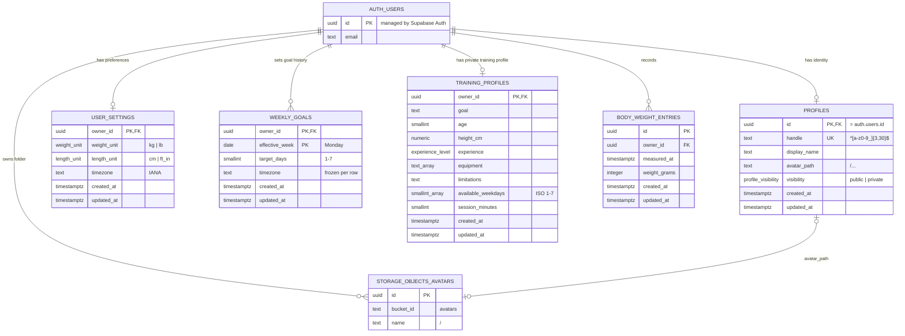
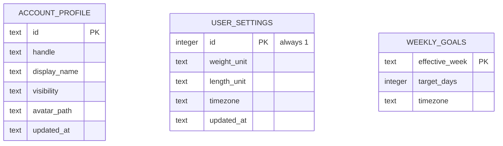

# Database diagram

Implemented schema as of M1 (2026-11-25). Column details and access rules: [DATA-DICTIONARY.md](DATA-DICTIONARY.md).
Planned entities (sessions, programs, posts, follows, rewards, sync) are in [DATA_AND_SYNC.md](DATA_AND_SYNC.md) and
will be added here as their migrations land.

## Server (Supabase)

Visibility: `PROFILES` is readable by any signed-in user; every other table is owner-only. `anon` has no access.

## Device (SQLite, one file per account)

Device tables are a cache of the signed-in account's server rows; the file itself is the account boundary,
so no owner columns are needed.
