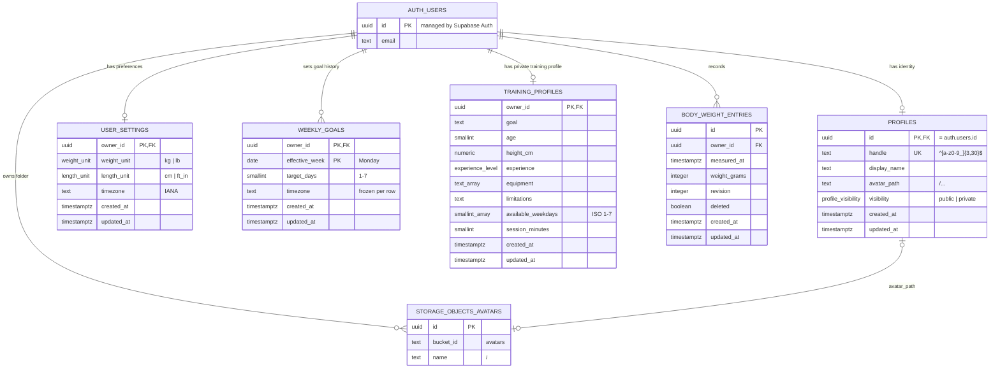
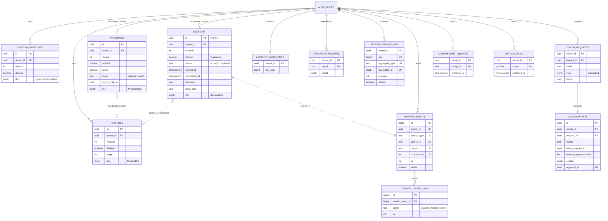
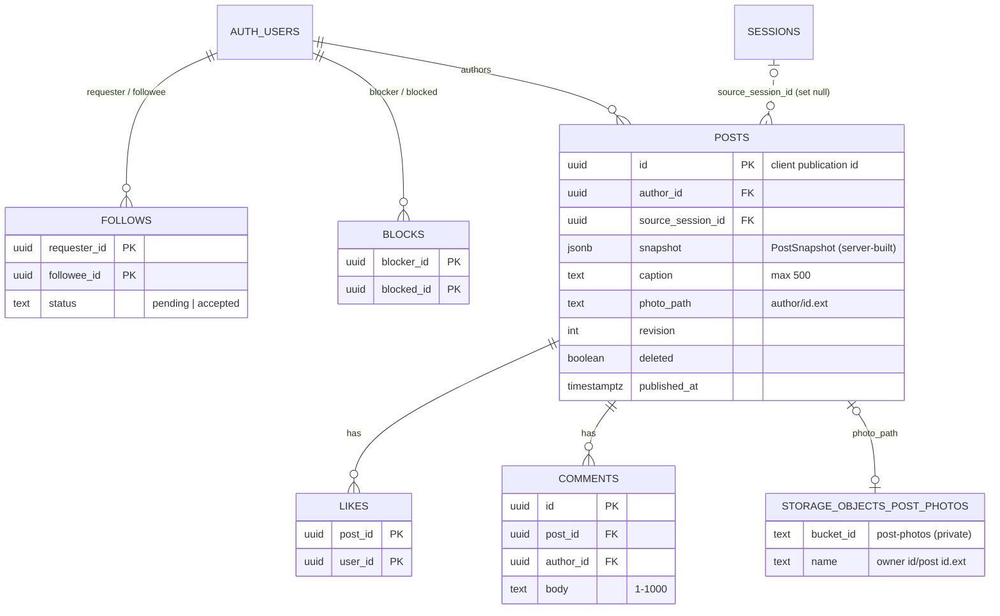
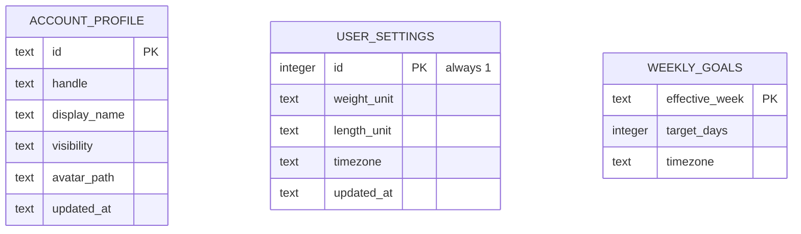

# Database diagram

Implemented server schema as of M6 (2026-11-25). Column details and access rules: [DATA-DICTIONARY.md](DATA-DICTIONARY.md).

## Server (Supabase)

Visibility: `PROFILES` is readable by any signed-in user (except across a block); every other table is owner-only. `anon` has no access.

### Training, sync, rewards and coach (M3-M5)

### Social (M6)

Post access: author, or no block either way and (author public or accepted follower).

## Device (SQLite, one file per account)

Device tables are a cache of the signed-in account's server rows; the file itself is the account boundary,
so no owner columns are needed.
