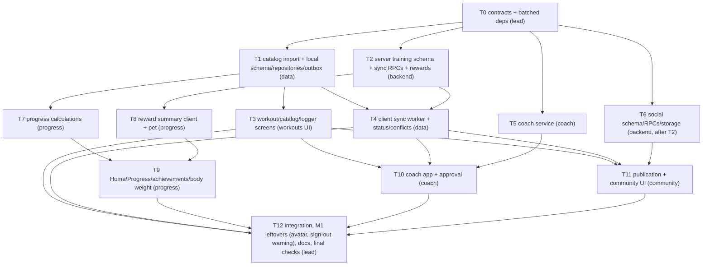

# Implementation plan

Derived from [DELIVERY_PLAN.md](DELIVERY_PLAN.md). Requirement IDs refer to [REQUIREMENTS.md](REQUIREMENTS.md);
decision/blocker IDs (`O-xx`, `D-xx`) refer to [DECISIONS.md](DECISIONS.md). Status as of 2026-11-25 (M2–M7 summary: [M2–M7 status](#m2m7-status-2026-11-25)):
**M0**: code and automated checks done; Android build/device verification **pending** (O-13, see
[M0 status](#m0-status-2026-11-25)). **M1**: implemented and verified against the local Supabase stack; device
verification pending with M0 (see [M1 status](#m1-status-2026-11-25)).
**Web (2026-11-26)**: the app runs on Expo web and its main flows were tested in a browser against the local stack
([web validation](#web-build-and-browser-validation-2026-11-26)); native device checks stay with the user.

## Dependency graph

```text
M0 Toolchain & native spike
 └─ M1 Backend foundation, auth, local DB
     └─ M2 Catalog & manual training (offline)
         └─ M3 Sync engine
             ├─ M4 Progress & gamification
             ├─ M5 AI coach            (graph/API with mocked model may start after M1+M2)
             └─ M6 Social              (needs M4 summary data for post snapshots)
                 └─ M7 Polish & release gates  (needs M4, M5, M6)
```

M5 and M6 can proceed in parallel once M3 is done. Do not start social features before sync fixtures exist (M3).

---

## M2–M7 status (2026-11-25)

All DAG tasks T1–T12 are implemented, integrated and committed. **Nothing has run on a device** (O-13): every
device-dependent acceptance criterion below stays open.

| Milestone | Code | Automated verification | Device / external |
| --- | --- | --- | --- |
| M0 | done | app checks pass | Android/iOS build pending (O-13, O-06) |
| M1 | done; avatar upload + pending-changes sign-out warning added | pgTAP, API isolation | device checklist pending; Google untestable (O-07) |
| M2 | catalog (1324 pinned entries, no media), custom exercises, routines, programs, sessions, logger, rest deadline, history, save-as-routine | real-SQLite repository + migration-upgrade tests | force-close recovery on device pending |
| M3 | server aggregates + `sync_push`/`sync_pull`, client worker, conflicts UI, status screen | pgTAP 07, end-to-end `test:integration` (7) | foreground/reconnect triggers on device pending; hosted Supabase O-14 |
| M4 | metrics, PR rules, consistency, body weight, server rewards/badges/pet, Home/Progress/achievements, placeholder pet (Rive + static) | calc fixtures, pgTAP 08, reward-rules parity API test | final art O-03; Rive on device pending |
| M5 | coach service (LangGraph, one repair, limits), coach tables/RPCs, approval via sync, profile/request/review/approve UI | pytest 31 + gated end-to-end test, pgTAP 09, RNTL | live Gemini O-08; hosting O-09 |
| M6 | follows/blocks/posts/likes/comments, private photos, server-built snapshots, feed/search/profiles/post/copy/publish UI | pgTAP 10, API isolation, RNTL | photo picker/upload on device pending |
| M7 | route wiring, offline/error/retry states, a11y pass, root QueryProvider, Maestro flows | full suites below | Maestro flows never executed; NFR-01 profiling needs O-10 |

Final checks (2026-11-25, from a clean `supabase db reset --local`):

| Check | Result |
| --- | --- |
| `npm run typecheck`, `npm run lint` (app) | pass, 0 problems |
| `npm test` (app) | 19 suites / 113 tests pass; 1 integration suite skipped by design |
| `npm run test:integration` (app, local stack) | 7 / 7 pass |
| `supabase db lint --local --level warning` | no schema errors |
| `supabase test db` | 10 files / 180 assertions pass |
| `node --test supabase/tests/api/*.test.mjs` | 12 / 12 pass |
| coach `pytest` (local env exported) | 32 pass (31 unit/evaluation + 1 end-to-end) |
| Not run (per session rules) | native builds, `expo export`, `expo-doctor`, Maestro, live Gemini |

Known limits (recorded, not hidden): identity/preference edits are online-only (D-28); a pulled change failing
local validation is skipped with a visible error (D-29); history paging uses a strict `before` timestamp, so two
workouts finished in the same millisecond at a page boundary can be skipped; like counts are computed client-side.

**Next device checkpoint (single native build):** this build adds `expo-crypto`, `expo-image-picker` (photos
permission only), `@react-native-community/netinfo` to the M0/M1 natives. After O-13: `npm run android`, then run
the M0 and M1 checklists and `app/maestro/*.yaml` (see [app/maestro/README.md](../app/maestro/README.md)).

## Web build and browser validation (2026-11-26)

The user moved validation to the browser and handles Android/iOS device checks. The app now runs on Expo web
from the same code (D-35, setup: [SETUP.md](SETUP.md#2b-web-browser)). Tested in the Orca embedded browser
(Chromium 150) against the local Supabase stack and the local coach service without Gemini credentials, with two
isolated browser profiles (Alice, Bob) and sequential sign-ins in one profile. Database state was checked with
`psql` in the local DB container, not inferred from the UI.

| Flow | Result |
| --- | --- |
| Sign-up → Mailpit confirmation link → callback → onboarding | pass (after fixes 1, 2, 8) |
| Sign-in, sign-out, password reset via email link → new password → signed in | pass |
| Catalog search + muscle/equipment filters; custom exercise create (synced) and isolation from another account | pass |
| Routine create/edit, program create + activate (server rows checked) | pass |
| Workout: add exercise, sets, complete, rest timer, finish, summary, server reward (100 XP) | pass (after fixes 3, 4, 5, 9) |
| Reload during workout and close/reopen tab: active workout, typed reps and rest deadline restored | pass |
| History edit (lb input stored as grams) and delete with server reward recalculation (200 → 100 XP) | pass (after fix 6) |
| Offline (browser offline emulation): log a workout, edit settings (unit, name, goal) → pending labels; reconnect → synced, server rows checked | pass |
| Pending-change sign-out: dialog (Sync now / Cancel / Discard); Sync now offline keeps the session with an error; Discard offline signs out and re-sign-in rehydrates server data | pass |
| Account switch in one browser: Bob sees none of Alice's routines/workouts/custom exercises; Alice's data returns | pass |
| Units: kg↔lb display and entry, body weight entry stored as grams | pass |
| Progress, records, weekly consistency, achievements | pass |
| Private profile: Bob cannot read Alice's post (UI and direct REST/Storage calls with Bob's token); follow request → accept → visible; public profile visible without follow | pass |
| Like, comment, copy-to-routine; block hides post and profile from the blocked user | pass |
| Photo publication: non-image bytes rejected before upload; PNG uploaded with detected type; offline publish → retry → one post, one object; double-click Publish → one post | pass |
| Coach without credentials: real API call (CORS) returns "coach is not configured" with retry | pass; live Gemini **not tested** (no credentials, O-08) |
| Rive on web (same `rating.riv`), static fallback offline, reduced motion → static (no canvas); page loads only from `localhost:8081` and `127.0.0.1:54321` (Rive wasm and its fallback served locally, 140fb72) | pass |
| Desktop 1289 px, phone 412 px (Pixel 9 emulation), 200 % zoom: no horizontal scroll, tabs and titles visible | pass (after fix 10) |
| Keyboard: Tab order through the logger, visible focus outline, Enter activates, Escape closes the picker and returns focus | pass |

Bugs found in the browser and fixed (native code paths marked † are shared, so they were native bugs too):

| # | Bug | Commit |
| --- | --- | --- |
| 1 | SSR (`web.output: server`) evaluated native-only modules; `openDatabaseSync` failed before the wasm worker loaded | `ccf777a` |
| 2 | Protected routes redirected web URLs to the bare `(auth)` group; the callback exchanged one code twice | `ccf777a` |
| 3 | † React Compiler cached `useLocalQuery` reads: saved sets/exercises appeared only after a reload | `102a3eb` |
| 4 | `Alert.alert` is a no-op on react-native-web: confirmations and save errors vanished; † guards redirected deep links while loading | `1e8a8d3` |
| 5 | † Committing reps remounted the set row and dropped the typed weight | `0dfee09` |
| 6 | † Save in history edit used a stale draft and lost the last edited field | `1b0b7db` |
| 7 | † Radios reported unchecked to assistive tech; toggle chips exposed no state on the web | `62ec230` |
| 8 | Reopening a used confirmation link left a signed-in user on an error page | `2ce69be` |
| 9 | † "Pending sync" line appearing on each write moved the Complete button mid-press (press lost) | `562e527` |
| 10 | Web top tab bar covered screen titles on phone widths; back buttons read "(tabs)" | `e879c5d` |

Also: coach API opt-in CORS (`fd32d43`), web auth redirect URL in local `config.toml` (`192fe79`).

Still **not verified** (native, awaiting the user): everything on Android/iOS devices — build, SecureStore,
native Rive, image picker, deep links `aigym://`, TalkBack/VoiceOver, large text, background/foreground sync,
force-close recovery, Maestro flows, set-save latency. Fixes marked † change shared code and need that device pass.

Remaining web limitations: training data lives in the browser's origin storage (clearing site data discards
unsynced changes; one active tab per account, see below); sessions in `localStorage`; Google sign-in untested (provider disabled, O-07); Rive logs its own console
error when the `.riv` cannot load offline (the static pet is shown); screen
readers on the web were checked through the accessibility tree only (no NVDA/JAWS/VoiceOver run); deployment
headers (COOP/COEP) and web hosting are not set up.

### Web reliability follow-up (2026-11-26)

| Check | Result |
| --- | --- |
| Regular Chrome 158 (headed, throwaway profile, driven over CDP): headers and `crossOriginIsolated` on initial load of `/`, 4 reloads, direct navigation to `/progress` and `/workouts`, cross-origin hop and back | **failed first**: initial `/` had no COOP/COEP and was not isolated. Cause: Expo CLI serves `/` from its manifest middleware ahead of Metro, so `enhanceMiddleware` never ran for it; deep URLs were fine. The Orca "alternating reloads" were the same bug (reloading `/` vs `/sign-in`). Fixed in `98f9596`; rerun: isolated with both headers on every load in Chrome, 5/5 reloads in Orca |
| Two tabs, same account (same browser profile) | **failed first**: second tab could not open the OPFS database and showed "No connection" with a raw browser error. Now one active tab per account (`8391ef6`): second tab shows "Open in another tab" + Retry; holder reloads keep the lock (3/3); a workout finished in tab 1 synced once (server: 2 events, 200 XP, unchanged after tab 2 took over); an offline routine edit in a closed tab synced from the next tab; sign-out in one tab moved the other to sign-in; signing in again leaves exactly one active tab (a sign-in race that opened the database without the lock was found and fixed in the same commit) |
| Simultaneous edits in two tabs | not possible by design now (the second tab cannot open the database), so no lost writes or duplicate rewards from concurrent writers |
| Coach integration tests with the local env exported | 5/5 pass (scripted model + local Supabase; no Gemini needed). Full coach suite: 51 pass. No external blocker |

## Android build attempt via WSL (2026-11-25/26)

Route: Ubuntu WSL2 (Linux paths, no 260-char limit), user-space toolchain (Node 24.13, Temurin 17, Android
cmdline-tools, NDK 27.1.12297006, CMake 3.22.1, platforms 36/37), fresh clone of `main` at `34ab8bb` on ext4,
`npm ci --ignore-scripts` (dev-only `better-sqlite3` needs `make`, not installed: no sudo), `expo prebuild`,
`./gradlew assembleDebug -PreactNativeArchitectures=x86_64`.

| Attempt | Furthest point | Stopped by |
| --- | --- | --- |
| 1 | `:expo:generateInlineModules` | my malformed `gradle.properties` append (fixed) |
| 2 | `:react-native-screens:buildCMakeDebug` | WSL kernel OOM kill of Gradle JVM (7.8 GB VM cap) |
| 3–4 | configuration / `:react-native-gesture-handler:compileDebugKotlin` | Ubuntu instance torn down (`Wsl/Service/E_UNEXPECTED`); host free RAM 0.7–1.4 GB, commit ~33/36 GB; once by Modern Standby overnight |
| 5 | `:react-native-reanimated` native C++ (22 compiler processes) | OOM kill (2 workers did not bound ninja) |
| 6 | native C++ with `taskset -c 0-2` | `Wsl/Service/E_UNEXPECTED` again (host memory) |

Kotlin/Java compilation of all modules completed (incremental outputs kept in the WSL clone); **no APK was
produced**, so no device check (M0/M1 checklists, Maestro, set-save latency) has been executed.

Needed to finish (user action, pick one):
1. Free host memory: close other heavy apps (VS Code windows, browsers) and stop Docker/Supabase during the build,
   then rerun the same incremental command; or
2. Add `%USERPROFILE%\.wslconfig` with e.g. `[wsl2]` `memory=8GB` `swap=8GB` `processors=4`, run `wsl --shutdown`,
   rerun (global WSL setting; affects Docker Desktop); or
3. Enable Windows long paths (admin: `LongPathsEnabled=1`) and build natively on Windows; or
4. EAS Build (needs an Expo account, O-06).

## Risk closure (2026-11-25)

| Risk | Result | Evidence |
| --- | --- | --- |
| Account switch between the account check and request dispatch | **Race demonstrated and fixed**: A's queued routine was stored with `owner_id = B`. RPCs now send the issuing account's token explicitly after checking user id and token `sub`; a generation counter discards late responses after sign-out/switch (op stays inflight, resent idempotently). | `app/src/services/sync/account-isolation.test.ts` (5, failed before fix), gated `sync.integration.test.ts` (11/11) |
| Concurrent coach limits | No race found: one winner for the last hourly and daily slot, rejected attempts use no budget, 6 concurrent duplicate POSTs make 1 provider call and 1 draft. Tests not mutation-checked against a broken version. | `services/coach-api/tests/test_integration_local.py` (passed 3 consecutive runs; full suite 50) |
| Readiness script branches | Restart-once success, terminal failure after 10 bounded re-probes, no Kong container, non-local URL refusal | `node --test scripts/supabase-ready.test.mjs` (5/5, command stubs) |
| Python dependency advisories | `pip-audit` (isolated scratch venv) on the 56 frozen coach packages: no known vulnerabilities | run 2026-11-25 |
| Invalid image uploads | Local Storage enforces only the declared MIME label and size (HTML labelled `image/png` and a 30000×30000 header-only PNG were accepted). Client now checks real signature, header dimensions ≤ 4096 and byte limits before upload. **Not a trusted boundary**: a modified client can bypass it; server-side inspection would need a new service (not added). | `app/src/services/image-validation.test.ts` |
| Full-history progress work during logging | 20 set saves with logger + hidden Home/Progress: 0 history reads, 0 consistency recomputations (was 22). Ceiling: full-history read (one query per session) still runs on focus and is unbounded in history size. | `app/src/features/progress/screens.test.tsx` |

External-release prerequisites remain open under O-11 (account deletion incl. Storage cleanup, age eligibility,
reporting, final privacy decisions). Recorded proposals in DECISIONS.md are not user acceptance of those risks.

## Review pass (2026-11-25)

Independent review by five parallel reviewers (data/sync, security, coach, screens, performance/docs); fixes
committed with regression tests. Findings and resolutions:

| Severity | Finding | Fix |
| --- | --- | --- |
| High | Sync adapter used whichever session was current: an account switch mid-cycle could push A's ops as B or pull B's data into A's DB (`app/src/services/sync/supabase-rpc.ts`) | adapter bound to one user id; foreign session pauses sync |
| High | Records/XP/"new record" computed from the last 50 sessions only (`features/progress/use-progress-data.ts`) | read full history |
| High | Coach approval compared the client-sent base, so a stale draft could be re-based; edited content not revalidated | base must equal the draft's; content checked against stored draft (D-32) |
| High | Late model result could report a cancelled draft as ready; daily operator cap per process only | `coach_save_draft` pending-only transitions; DB-backed caps (D-33) |
| High (perf) | Hidden Home/Progress recomputed history on every set save; logger rerendered every row each second | focus-gated reads; isolated clock/timer components |
| Medium | History, feed and comments paged by timestamp only (ties skipped) | `(timestamp, id)` keyset cursors + index; API and SQLite tie tests |
| Medium | Profile/settings edits online-only despite PROFILE-02/SETTINGS-01 offline use (D-28) | `account_settings` sync aggregate (D-30) |
| Medium | Startup refresh overwrote pending settings edits | skipped while pending/conflict |
| Medium | Avatars readable across blocks; `has_weekly_goal` leaked other accounts' onboarding state; anon execute on helpers | block-aware avatar policy, caller-only helper, grant cleanup |
| Medium | Coach 90 s budget did not cover DB calls; Gemini errors unmapped; stuck `pending` polled forever | one deadline; error mapping tested through the real adapter; bounded polling with re-ask |
| Medium | "Delete both" deleted the workout when post deletion failed; missing confirmations; photo failure spinner | fixed with RNTL tests |
| Medium | Feed like/comment counts ran per-row RLS | definer count helper |
| Low | Post-reset 502 (Kong stale upstream IPs); back-to-back suites hit local sign-in limit | `scripts/supabase-ready.sh`; local limit 300 (D-34) |
| Low (open, not user-accepted) | Direct `coach_save_draft` by a user (D-32 proposal); private post counts on profile cards; files left on account deletion | recorded under O-11 as external-release prerequisites; recording is not user acceptance |

Dependency audit: `npm audit` reports 20 (prod tree) / 26 (full) moderate advisories, all in build/test tooling
(minimatch via `@expo/fingerprint`, jest/glob, esbuild via drizzle-kit), not app runtime; suggested fixes are
breaking downgrades and were not applied. `pip-audit` unavailable, so no Python advisory scan was run.

Final verification after the review (fresh `supabase db reset --local`, then `scripts/supabase-ready.sh`):

| Check | Result |
| --- | --- |
| `npm run typecheck`, `npm run lint` (app) | pass, 0 problems |
| `npm test` (app) | 21 suites / 140 tests pass; integration suite skipped by design |
| `npm run test:integration` (app, local stack) | 10 / 10 pass |
| `supabase db lint --local --level warning` | no schema errors |
| `supabase test db` | 13 files / 248 assertions pass |
| `node --test supabase/tests/api/*.test.mjs` | 21 / 21 pass (run twice, back to back with the other suites) |
| coach `pytest` (local env exported) | 47 pass |
| Mermaid diagrams | structural check only (no browser renderer available) |
| Not run | native builds, `expo export`, `expo-doctor`, Maestro, live Gemini, device performance |

Known limits after review: two workouts or posts can still race only at the database level for direct writes
(app uses RPCs); a tiny window exists between the session check and a request inside supabase-js; hourly coach cap
verified sequentially, not under real concurrency; the floating resume bar position over native tabs needs a device.

## Execution DAG (2026-11-25, M2–M7 session)

Contracts are frozen in [CONTRACTS.md](CONTRACTS.md). Tasks run in parallel as soon as prerequisites are done;
a task counts as integrated only against its real dependency. One owner per path; the lead owns
`app/package.json`, lockfile, `app/app.json`, `app/src/domain/*`, root navigation and consolidated docs.



| Task | Milestone | Requirements | Owner paths |
| --- | --- | --- | --- |
| T1 | M2 | CAT-01/02, PLAN-01, SESSION-01..04, NFR-02/03 | `app/src/db/**`, `app/scripts/**`, `app/assets/catalog/**` |
| T2, T6 | M3, M4, M6 | SYNC-01, GAME-01, SOCIAL-01..05, NFR-04 | `supabase/**` |
| T3 | M2 | CAT-01/02, PLAN-01, SESSION-01..04 | `app/src/features/{catalog,workouts}/**`, their routes |
| T4 | M3 | SYNC-01, AUTH-02, NFR-08/09 | `app/src/services/sync/**`, `app/src/features/sync/**` |
| T5, T10 | M5 | COACH-01/02, PROFILE-01, NFR-05/10 | `services/coach-api/**`, `app/src/features/coach/**` |
| T7–T9 | M4 | PROGRESS-01, GAME-01/02, NFR-11 | `app/src/features/{progress,gamification}/**`, `app/src/components/characters/**` |
| T11 | M6 | SOCIAL-01..05 | `app/src/features/community/**` |
| T12 | M1, M7 | AUTH/PROFILE leftovers, NFR-06/08/09 | lead |

## M0 — Toolchain and native compatibility spike

**Requirements:** NFR-07, NFR-12. **Depends on:** nothing.

Work:
- (Done by hand, D-12; the `reset-project` script no longer exists.) Run `npm run reset-project` in `app/` (moves starter to `app/example/`, which is gitignored), or delete
  starter screens deliberately; keep `src/app/` thin.
- Fix the 3 current `npx tsc --noEmit` errors; configure ESLint (`npm run lint`) and jest-expo + RNTL with
  one real test; add `typecheck`/`test` npm scripts and record them in [AGENTS.md](../AGENTS.md#commands-verified-against-this-repository-on-2026-11-25).
- Set app name/scheme/bundle IDs (blocked on **O-05**).
- `npx expo install expo-sqlite expo-dev-client`, Rive + Nitro, and confirm Reanimated/worklets already present.
- Central tab shell (Home, Workouts, Coach, Community, Progress) with placeholder screens.
- Spike screen: write a row to SQLite, force-close, reopen, read it; play a sample Rive file with a static
  fallback; run a Reanimated keyframe respecting reduced motion; open a deep link via the scheme.

Likely files: `app/package.json`, `app/app.json`, `app/eas.json` (if EAS chosen), `app/src/app/_layout.tsx`,
`app/src/app/(tabs)/*`, `app/src/components/app-tabs.tsx`, `app/src/navigation/tabs.ts`, `app/jest.config.js`.

Acceptance: typecheck, lint, and tests pass; Android and iOS development builds run the spike; `npx expo-doctor`
clean or findings documented.
Blockers: **O-04** Rive compatibility, **O-05** identifiers, **O-06** iOS build path.

### M0 status (2026-11-25)

**Done (code):** starter demo removed (D-12); central tab shell `app/src/navigation/tabs.ts` + thin routes in
`app/src/app/(tabs)/`; dev-only route `app/src/app/dev/verify.tsx` →
`app/src/features/dev-verification/` (SQLite probe, Rive sample with static fallback, Reanimated keyframe with
`ReduceMotion.System`, deep-link param); provisional identifiers `com.rubenyh.aigym` / scheme `aigym` (O-05);
Rive sample `app/assets/rive/rating.riv` with [attribution](../app/assets/rive/ATTRIBUTION.md); ESLint, jest-expo.

Installed native packages: `expo-sqlite ~58.0.18`, `expo-dev-client ~58.0.21`, `@rive-app/react-native 0.5.18`,
`react-native-nitro-modules 0.36.5` (D-11); Reanimated 4.7.1 / worklets 0.13.0 and Expo Router were already present.

| Check | Command (from `app/`) | Result |
| --- | --- | --- |
| Typecheck | `npm run typecheck` | pass |
| Lint | `npm run lint` | pass, 0 problems |
| Unit tests | `npm test` | pass, 2 suites / 11 tests (tab config ↔ route files; Rive fallback; SQLite count read-back; deep-link param) |
| Dependency health | `npx expo-doctor` | 20/20 checks passed |
| Android JS bundle | `npx expo export --platform android --output-dir <tmp>` | pass; Hermes bundle built, `rating.riv` included as asset |
| Android native build | `npm run android` (emulator `Medium_Phone_API_36.1`, JDK 17) | **FAIL — environment blocker O-13** |
| Android device verification | manual steps below | **not performed** (no installed build) |
| iOS build / device | — | **pending O-06** (config prepared, not verified) |

Unit tests mock the Rive runtime and SQLite; they do not prove native behavior.

**Android build failure (O-13).** Prebuild succeeds; Gradle fails in native CMake/ninja steps with
`ninja: error: mkdir(CMakeFiles/reanimated.dir/C_/repos/clases/heterogenas/ai-gym-app/app/node_modules/react-native-reanimated/Common/cpp/reanimated/CSS/common/filters): No such file or directory`.
Windows `HKLM\SYSTEM\CurrentControlSet\Control\FileSystem\LongPathsEnabled` is `0`, so object paths over 260
characters fail. Attempts: CMake 3.31.6 (ninja 1.12.1) via `cmake.dir` in gitignored `app/android/local.properties`
— same error; `subst` short drive — Gradle resolves back to the long path; temporary worktree at `C:\ag` —
Reanimated compiled but `react-native-gesture-handler` codegen still exceeded 260 characters. Not a package
incompatibility: no package was downgraded or swapped.

Resolution options (user decision): enable Windows long paths (admin, then reboot/new shell) and keep CMake
3.31.6; or build in WSL/Linux; or EAS Build (account, see O-06).

**Reproduce / finish verification after O-13 is resolved:**

```bash
cd app
npm ci
# Windows only: Android SDK CMake 3.31.6 and long paths enabled
#   sdkmanager "cmake;3.31.6"
#   echo cmake.dir=C:/Users/<you>/AppData/Local/Android/Sdk/cmake/3.31.6 >> android/local.properties  (after prebuild)
npm run android                 # prebuild + Gradle build + install com.rubenyh.aigym on emulator/device
npx expo start                  # Metro for the development build
adb shell am start -W -a android.intent.action.VIEW -d "aigym://dev/verify?source=adb" com.rubenyh.aigym
```

Device checklist (record device, OS version, result):
1. Deep link opens **M0 verification** showing `Opened via deep link (source=adb)`.
2. Press **Increment and save** twice; note count; `adb shell am force-stop com.rubenyh.aigym`; reopen via deep link; count unchanged.
3. Rive sample animates; **Force static fallback** shows the static character; screen stays usable.
4. **Replay keyframe** pops the badge; enable Settings → Accessibility → Remove animations, relaunch: badge appears
   without animating, status text says reduced motion on, Rive autoplay off.
5. All five tabs render; Home shows the dev link only in development builds.

M0 exit remains open until steps 1–5 pass on Android. iOS repeats them after O-06.

## M1 — Backend foundation, auth, account-scoped local DB

**Requirements:** AUTH-01, AUTH-02, PROFILE-02, NFR-04, NFR-05, NFR-08, SETTINGS-01 (preferences storage).
**Depends on:** M0.

Work:
- Supabase migrations: `profiles`, `user_settings`, `weekly_goals`, `training_profiles`, `body_weight_entries`
  with RLS; pgTAP tests in `supabase/tests/` for owner-only access across two accounts.
- Supabase client with supported session persistence (secure storage where feasible); email/password, reset,
  verification, Google sign-in with return to the app scheme.
- Per-account SQLite file (D-10), Drizzle schema + migrations run before any query; sign-out warns about
  pending changes.
- Onboarding: handle, display name, units, timezone, weekly goal.

Likely files: `supabase/migrations/*`, `supabase/tests/*`, `supabase/config.toml` (redirect URLs, Google),
`app/src/services/supabase/*`, `app/src/db/{schema,migrations,client}.ts`, `app/src/features/auth/*`,
`app/src/features/onboarding/*`.

Acceptance: `supabase test db` proves account B cannot read A's private rows; sign-in → onboarding → Home;
offline relaunch of a signed-in user reaches local data without a login loop; switching accounts shows no
previous-account data.
Blockers: **O-05**, **O-07** Google credentials (email/password not blocked).

### M1 status (2026-11-25)

**Implemented**
- Server: migration `supabase/migrations/20261125120000_m1_identity_settings.sql` — `profiles`, `user_settings`,
  `weekly_goals`, `training_profiles`, `body_weight_entries`, private `avatars` bucket; constraints, index, explicit
  grants (none for `anon`), RLS on every table, frozen weekly-goal history, timezone change from next week, atomic
  `complete_onboarding` and `schedule_weekly_goal` RPCs. Documented in [DATA-DICTIONARY.md](DATA-DICTIONARY.md)
  and [DB-DIAGRAM.md](DB-DIAGRAM.md).
- `supabase/config.toml`: `site_url = "aigym://"`, redirect allowlist `aigym://**`, email confirmations on, Google
  provider block present but disabled (env references, O-07).
- App: Supabase client (`app/src/services/supabase/`) with PKCE and chunked `expo-secure-store` session storage;
  generated DB types; per-account SQLite file with Drizzle schema/migrations (`app/src/db/`); account provider and
  route guards (signed-out → auth, no profile → onboarding, otherwise tabs; cached account opens offline);
  sign-in, sign-up with email confirmation, password reset, `auth/callback` return route, Google OAuth action;
  onboarding; Profile & settings (display name, visibility, units, timezone, weekly goal from next week, sign-out).

**Checks run**

| Check | Command | Result |
| --- | --- | --- |
| Migration from scratch | `supabase db reset --local` (repo root) | pass |
| Schema lint | `supabase db lint --local --level warning` | no errors |
| Database permission tests | `supabase test db` | pass, 6 files / 60 assertions (two accounts, anon, frozen goals, RPC atomicity, storage folders) |
| API isolation (PostgREST, RPC, Storage) | `set -a; eval "$(supabase status -o env)"; set +a; node --test supabase/tests/api/*.test.mjs` | pass, 6 tests |
| Auth redirect allowlist | ad-hoc sign-up/reset against local stack, links read from Mailpit | `aigym://auth/callback` and `…?next=reset-password` accepted |
| App typecheck / lint / unit tests | `npm run typecheck`, `npm run lint`, `npm test` (in `app/`) | pass; 6 suites / 32 tests (secure-storage chunking, account-state offline resolution, per-account DB isolation, validation) |

Native config changed (`expo-secure-store` config plugin in `app.json`; new JS deps `@supabase/supabase-js`, `drizzle-orm`, `zod`): the next development build must include them. No native build was run this milestone.

**Not verified (needs a device build, O-13):** screens and route guards on a device, secure-store persistence,
email-link deep links into the app, offline relaunch, account switch on one device. Google sign-in is untestable
until O-07. The device checklist for M1 is added to the M0 checklist run.

**Deferred inside M1 scope (recorded, not dropped)**
- Avatar picking/upload UI: storage and policies exist; picker needs `expo-image-picker` (native dependency) — add
  with the next native build.
- Training-profile form (PROFILE-01): table and RLS exist; form lands with the coach flow (M5), where it is first
  required.
- Settings and profile edits are online-only until the M3 outbox; offline they show the cached values and an error.
- Sign-out pending-changes warning (NFR-08): nothing is pending before the M2 outbox; add the warning with it.

M1 device checklist (with M0 checklist, after O-13): sign up → confirm link opens app → onboarding → Home; force-stop
offline relaunch reaches Home; sign out, sign in as a second account → no first-account data; password reset link
opens New password screen.

## M2 — Catalog and manual training (offline)

**Requirements:** CAT-01, CAT-02, PLAN-01, SESSION-01..04, SETTINGS-01, NFR-01, NFR-02, NFR-03 (migrations).
**Depends on:** M1.

Work:
- Import pinned dataset metadata (IDs as strings, counted/validated); no restricted media (**O-01**).
- Custom exercises (archive, never delete referenced definitions).
- Routine/program CRUD; session snapshots from routines; empty sessions; one active session.
- Logger: set complete/edit/add/remove, notes, previous results, rest timer with persisted deadline.
- Every mutation = SQLite change + outbox row in one transaction (outbox table exists now; sending is M3).
- Canonical units (integer grams), unit conversion at display/input only.

Likely files: `app/src/db/schema/*`, `app/src/db/repositories/*`, `app/src/features/workouts/*`,
`app/src/features/catalog/*`, `app/src/stores/active-workout-ui.ts` (transient only), `app/src/lib/units.ts`,
`scripts/import-exercises.*`.

Acceptance: force-close mid-workout recovers all committed sets; failed transaction leaves neither session
change nor outbox row; editing a routine leaves old sessions unchanged; unit switch changes display only;
migration upgrade fixture test.
Blockers: **O-02** dataset pin.

## M3 — Synchronization engine

**Requirements:** SYNC-01, AUTH-02, NFR-02, NFR-03, NFR-09. **Depends on:** M1, M2.

Work:
- Server: `operation_receipts`, `server_change_log`, revisions/tombstones on training tables; transactional
  RPCs per aggregate validating ownership and base revision; repeated operation ID returns prior result.
- Client: per-account serialized worker; ordered push per aggregate with rebasing of dependent commands;
  ordered paged pull applied with cursor in one transaction; pending local edits never overwritten.
- Conflict records with user recovery; backoff + jitter; auth pause/resume; sync status/retry screen.
- Triggers: foreground, reconnection, manual. No claims about background execution.

Likely files: `supabase/migrations/*sync*`, `supabase/tests/*sync*`, `app/src/services/sync/*`,
`app/src/db/schema/outbox.ts`, `app/src/features/settings/sync-status.tsx`.

Acceptance (see skill `verify-sync-rewards`): duplicate push and lost acknowledgement yield one session;
deletion propagates as tombstone; restart mid-sync resumes; conflict preserves both versions; expired
token pauses instead of spinning.

## M4 — Progress and gamification

**Requirements:** PROGRESS-01, GAME-01, GAME-02, NFR-11, NFR-06 (fallbacks). **Depends on:** M3.

Work:
- Central versioned rules config (XP, level curve, badge and pet thresholds) — D-03.
- Server-authoritative `reward_events` (unique source/reason/rule-version key), achievement/pet unlocks,
  derived in the session-sync transaction or an idempotent follow-up; local provisional values marked pending.
- PRs, volume, consistency with frozen weekly goals/timezones; body-weight history.
- Pet (Rive, placeholder asset) + coach character components with static fallback and reduced motion.

Likely files: `app/src/features/gamification/rules.ts`, `app/src/features/progress/*`,
`app/src/components/characters/*`, `supabase/migrations/*rewards*`, `supabase/tests/*rewards*`.

Acceptance: save/edit/delete/restore of a session never multiplies XP; missing weeks never subtract;
unit switch creates no PR; timezone/goal change keeps historical weeks; fixture tests for week boundaries.
Blockers: **O-03** final assets (placeholder allowed).

## M5 — AI coach

**Requirements:** COACH-01, COACH-02, PROFILE-01, NFR-05, NFR-10. **Depends on:** M1, M2 (catalog);
approval application needs M3.

Work:
- `services/coach-api/`: FastAPI, Supabase token verification, LangGraph nodes per [AI_COACH.md](AI_COACH.md),
  Pydantic contracts, deterministic validation, one repair, request-ID idempotency, rate limit.
- Provider adapter with mocked responses first; Gemini integration after **O-08**.
- `coach_requests`/`coach_drafts` tables with RLS; approval RPC with approval receipt + base-revision check.
- App: profile completeness, request form, status, draft editor, change summary, approve/cancel.

Likely files: `services/coach-api/**`, `supabase/migrations/*coach*`, `app/src/features/coach/*`,
`app/src/services/coach-client.ts`.

Acceptance: pytest evaluation cases from AI_COACH.md pass with mocked provider; invalid output/timeout never
modifies the active program; duplicate and stale approvals are rejected.
Blockers: **O-08** model/key (live only), **O-09** hosting/Python version.

## M6 — Social

**Requirements:** SOCIAL-01..05, PROFILE-02, NFR-04. **Depends on:** M3, M4.

Work:
- `follows`, `blocks`, `posts`, `likes`, `comments` with RLS honoring visibility, approved follows, and
  two-way blocks; private Storage bucket with short-lived URLs.
- Publication with stable publication ID, exact-field preview, recoverable photo upload, orphan cleanup.
- Feed, profile, comments, likes (TanStack Query, online-only); copy to independent routine (no XP).
- Permission refresh purges inaccessible cached rows.

Likely files: `supabase/migrations/*social*`, `supabase/tests/*social*`, `app/src/features/social/*`.

Acceptance (see skill `check-supabase-privacy`): two/three-account tests for public/private/follow/
remove/block/public→private; posts contain no private fields; failed upload keeps the session saved;
publish retry creates no duplicate.

## M7 — Polish and release gates

**Requirements:** NFR-01, NFR-06, NFR-09 and all [release gates](DELIVERY_PLAN.md#release-gates-for-the-prototype).
**Depends on:** M4, M5, M6.

Work: accessibility pass, reduced-motion and static-fallback audit, Lottie only where useful, Maestro smoke
suite (sign-in, offline workout recovery, publication), profiling on reference devices.
Blockers: **O-10** reference devices; **O-11** only if external release is planned.

---

## First concrete step

All milestones are code-complete. The next step is the device checkpoint above (needs O-13 or an EAS/Linux build),
then O-08 (Gemini model/key) for live coach evaluation.
