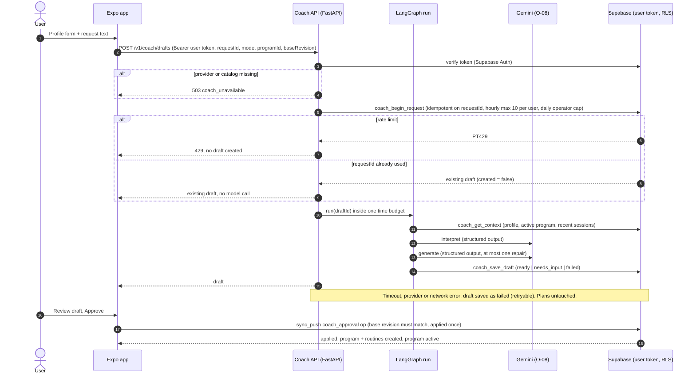
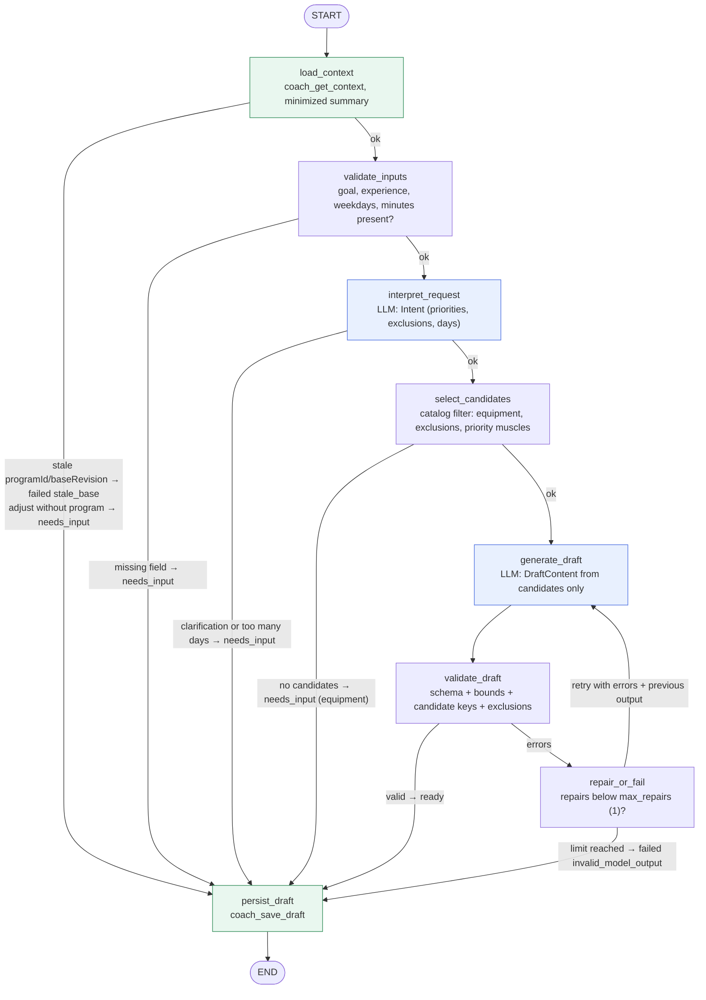

# AI coach graph

Diagram of the implemented coach agent. Source of truth is the code:
[`services/coach-api/coach_api/graph.py`](../../services/coach-api/coach_api/graph.py) (LangGraph state graph) and
[`services/coach-api/coach_api/main.py`](../../services/coach-api/coach_api/main.py) (HTTP API around it).
Behaviour and rules: [AI_COACH.md](AI_COACH.md). Update this page when a node or edge changes.

## Request lifecycle

The model never writes plans. The service only saves a **draft**; a plan changes only when the user approves it,
which travels through the normal sync protocol.

`POST /v1/coach/drafts/{id}/cancel` marks a pending draft cancelled; a late model result never overwrites a draft
that is no longer pending.

## LangGraph state graph

Every node may set `outcome`. The router `done_or(next)` sends the run to `persist_draft` as soon as an outcome
exists, otherwise to the next node. `generate_draft → validate_draft` and `persist_draft → END` are unconditional.

Blue nodes call the model; green nodes call Supabase with the user's token (RLS, no service-role key).

## Nodes

| Node | Reads | Writes to state | Can end the run with |
| --- | --- | --- | --- |
| `load_context` | `coach_get_context` | `profile`, `context_summary` (no social data, notes or loads; trimmed to `COACH_MAX_CONTEXT_CHARS`), `has_history` | `failed stale_base` (program changed or unsynced), `needs_input mode` (adjust without active program) |
| `validate_inputs` | profile | — | `needs_input` for goal, experience, availableWeekdays, sessionMinutes |
| `interpret_request` | summary, request text (wrapped in `<user_request>`) | `intent` (invalid model JSON → empty intent; code constraints still apply) | `needs_input` (model clarification, or more days requested than available) |
| `select_candidates` | bundled catalog | `candidates` (≤ `COACH_MAX_CANDIDATES`), `excluded_keys`, `repairs = 0` | `needs_input equipment` |
| `generate_draft` | summary, intent, candidates, `DRAFT_RULES`, previous errors | `raw` model output | — |
| `validate_draft` | `raw` | `errors`, or `outcome ready` with catalog names (not model names) and a no-history assumption when needed | `ready` |
| `repair_or_fail` | `repairs`, `errors` | `repairs + 1` | `failed invalid_model_output` |
| `persist_draft` | `outcome` | `saved` (stored draft returned to the API) | always ends |

## Outcomes

| Status | Meaning | Changes plans? |
| --- | --- | --- |
| `ready` | Valid draft for review | No — only an approved `coach_approval` push does |
| `needs_input` | One focused question (`clarification.field`, `question`) | No |
| `failed` | `stale_base`, `invalid_model_output`, `timeout`, `provider_error`, `data_unavailable` (retryable flags per error) | No |
| `cancelled` | User cancelled while pending | No |
